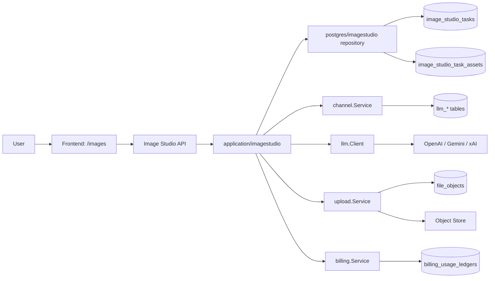
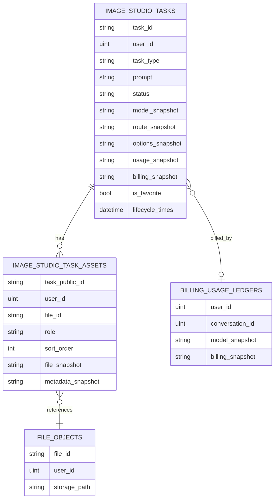
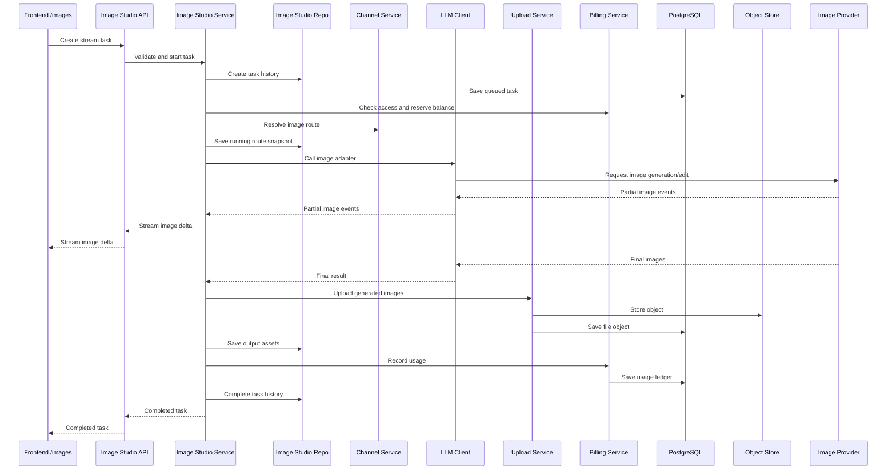
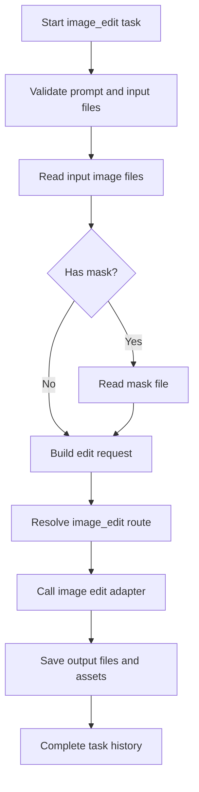
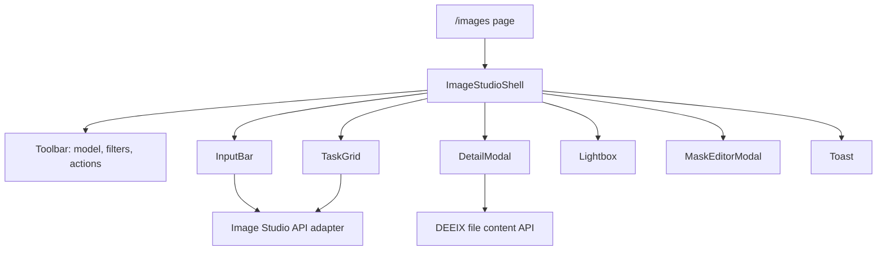

# Image Studio Integration Design

实施记录：[image-studio-integration-implementation.md](./image-studio-integration-implementation.md)

## 背景

本方案用于将 `/Users/kai/self/code/git-project/gpt_image_playground` 整合进 DEEIX-Chat，作为独立的生图模块。模块入口放在 DEEIX-Chat 侧边栏，复用 DEEIX 现有的模型供应商配置、模型路由、密钥轮询、计费、文件存储和用户权限体系。

核心约束：

- 生图模块不能污染聊天对话列表。
- 生图历史需要保存在云端。
- 集成代码尽量使用新增文件，减少后续合并 DEEIX 主线时的冲突。
- 不引入第二套 provider/baseUrl/apiKey 配置。

## 目标

- 新增独立 Image Studio 页面和侧边栏入口。
- 迁移 `gpt_image_playground` 的画廊工作台体验，包括任务网格、输入图、蒙版、参数面板、流式中间图、详情预览、收藏和下载。
- 新增独立 Image Studio 后端任务链路，不写入聊天会话、消息和聊天运行表。
- 新增独立数据库表保存云端任务历史。
- 生成结果仍保存到 DEEIX 文件对象和对象存储中。
- 继续复用 DEEIX 现有模型、路由、计费、存储和认证能力。

## 非目标

- 第一阶段不迁移 `gpt_image_playground` 的 provider/API key/baseUrl 设置页。
- 第一阶段不迁移 fal.ai、自定义 provider、dev proxy、Codex CLI 相关逻辑。
- 第一阶段不迁移 Agent 模式。
- 第一阶段不做公开分享。
- 第一阶段不把 Image Studio 任务混入聊天、最近对话、项目分组或会话搜索。

## 总体架构

Image Studio 是独立业务域。它复用 DEEIX 基础服务，但拥有自己的 API、应用服务、仓储和数据库表。

## 模块边界

### 后端

新增独立 Image Studio 业务域：

- Domain：定义 Image Studio 任务、资产、状态、分页视图。
- Repository：负责 Image Studio 任务历史和资产关联的持久化。
- Application Service：负责任务校验、路由解析、上游调用、文件保存、计费记录和任务状态流转。
- HTTP Transport：提供任务流式执行、列表、详情、删除、收藏等接口。

为降低合并冲突，现有文件只做必要注册：

- 数据库迁移注册。
- 应用依赖装配。
- HTTP 路由模块挂载。

### 前端

新增独立 `image-studio` feature：

- 页面入口：`/images`。
- API adapter：统一封装 Image Studio 后端接口。
- Store/hooks：维护筛选、分页、输入草稿、流式任务状态。
- Components：承载从 playground 迁移来的画廊工作台 UI。

现有前端只做必要入口扩展：

- 侧边栏新增“生图”入口。
- 中英文导航文案新增 `images`。

## 数据模型

云端历史建议由两类数据组成：

- Task：一次图片生成或图片编辑任务。
- Asset：任务关联的图片资产，包括输入图、蒙版、输出图。

图片本体仍由 DEEIX 文件系统负责，Image Studio 只保存任务历史和文件关联。

### Task 主体信息

Task 记录应覆盖：

- 任务身份：公开任务 ID、用户 ID、任务类型。
- 用户输入：提示词、请求模型、请求参数。
- 路由快照：实际平台模型、上游、协议、绑定编码、模型展示信息。
- 状态流转：排队、运行、成功、失败、取消以及开始/结束时间。
- 用量与计费：token 用量、耗时、计费金额、计费快照。
- UI 属性：收藏状态、更新时间。
- 错误信息：错误码和错误摘要。

### Asset 资产信息

Asset 记录应覆盖：

- 所属任务。
- 文件对象 ID。
- 资产角色：输入图、蒙版、输出图。
- 展示顺序。
- 文件快照：文件名、MIME、大小、hash。
- 上游补充信息：例如 revised prompt。

### 索引方向

索引应优先服务这些查询：

- 按用户分页查看历史。
- 按用户筛选成功/失败/运行中任务。
- 按用户查看收藏。
- 按任务查询资产。
- 按文件反查任务引用，避免删除时误删复用文件。

## 计费设计

Image Studio 继续复用 `billing.Service`：

- 调用前校验模型是否可用。
- 按量模式下预扣余额。
- 上游成功后构建并写入用量账本。
- 失败时释放预扣。

第一阶段不建议改 billing 表结构。Image Studio 对应的账本记录可使用 `conversation_id = 0`，同时把计费快照冗余保存到 Image Studio task 中，方便任务历史直接展示成本。

后续如果需要更强的账本来源关联，可以再考虑在 billing ledger 增加来源字段，例如来源类型和来源 ID。但这会扩大迁移影响，第一阶段不建议。

## API 设计

所有接口都挂在鉴权后的 `/api/v1/image-studio` 下。

建议提供：

- 创建并流式执行任务。
- 查询任务列表。
- 查询任务详情。
- 删除任务。
- 收藏或取消收藏任务。

流式事件沿用 DEEIX 现有媒体任务风格：

- 状态事件：任务进入排队、运行、保存结果等阶段。
- 图片增量事件：上游支持流式图片时返回中间图。
- 用量事件：返回上游用量。
- 完成事件：返回任务和资产结果。
- 错误事件：返回错误摘要。

生成和编辑可以共用一个任务接口，由 `taskType` 区分。也可以拆成生成和编辑两个接口，但共用任务接口更贴合云端历史模型。

## 执行流程

### 生图任务

### 图片编辑任务

图片编辑比纯生成多三个步骤：

- 校验输入文件必须是图片。
- 读取输入图和可选蒙版。
- 将输入图、蒙版和提示词组装为上游图片编辑请求。

## 前端设计

### 页面结构

### 迁移范围

第一阶段迁移：

- 画廊模式。
- 输入栏和参数选择。
- 输入图上传和排序。
- 蒙版编辑。
- 任务网格和任务卡片。
- 详情弹窗和 Lightbox。
- 收藏、下载、重试、再次编辑。
- 流式中间图预览。

第一阶段不迁移：

- provider/API key/baseUrl 设置。
- fal.ai、自定义 provider、dev proxy。
- Agent 模式。
- PWA service worker。
- Codex CLI 相关能力。

### 前端状态

云端任务历史以服务端为准。前端本地状态只保存：

- 当前输入草稿。
- 任务列表分页缓存。
- 正在流式执行的临时中间图。
- UI 偏好，如筛选、排序、面板展开状态。

IndexedDB 可用于缩略图或临时图片缓存，但不是历史事实来源。

## 与现有能力的复用关系

| 能力 | 复用方式 |
| --- | --- |
| 用户认证 | 复用现有 Auth middleware |
| 模型列表 | 复用公开模型列表，前端筛选 `image_gen` / `image_edit` |
| 模型路由 | 复用 channel 路由解析 |
| 密钥轮询 | 复用 channel API key 选择策略 |
| 熔断/退避 | 复用 channel route failure/success 标记 |
| 上游协议 | 复用 LLM 图片适配器 |
| 文件存储 | 复用 upload service、file objects 和对象存储 |
| 计费 | 复用 billing service |
| 对话列表 | 不复用，不写 chat 表 |

## 冲突控制策略

为了降低后续合并冲突：

- Image Studio 后端逻辑全部放在 `imagestudio` 新包中。
- Image Studio 前端逻辑全部放在 `frontend/features/image-studio` 新目录中。
- 不修改现有 chat 组件和 conversation service。
- 不改现有 provider 配置页面。
- 不改现有文件库页面。
- 现有文件只做必要注册和入口扩展。

## 参考文件

### DEEIX-Chat 后端参考

- `/Users/kai/self/code/git-project/DEEIX-Chat/backend/internal/application/conversation/service_media_generation.go`
- `/Users/kai/self/code/git-project/DEEIX-Chat/backend/internal/transport/http/conversation/handler_media.go`
- `/Users/kai/self/code/git-project/DEEIX-Chat/backend/internal/infra/llm/adapter.go`
- `/Users/kai/self/code/git-project/DEEIX-Chat/backend/internal/infra/llm/openai_images.go`
- `/Users/kai/self/code/git-project/DEEIX-Chat/backend/internal/infra/llm/gemini_images.go`
- `/Users/kai/self/code/git-project/DEEIX-Chat/backend/internal/infra/llm/xai_images.go`
- `/Users/kai/self/code/git-project/DEEIX-Chat/backend/internal/application/channel/service_routing.go`
- `/Users/kai/self/code/git-project/DEEIX-Chat/backend/internal/application/upload/service.go`
- `/Users/kai/self/code/git-project/DEEIX-Chat/backend/internal/application/billing/service.go`
- `/Users/kai/self/code/git-project/DEEIX-Chat/backend/internal/infra/persistence/postgres/postgres.go`
- `/Users/kai/self/code/git-project/DEEIX-Chat/backend/internal/infra/persistence/models/chat.go`
- `/Users/kai/self/code/git-project/DEEIX-Chat/backend/internal/infra/persistence/models/billing.go`
- `/Users/kai/self/code/git-project/DEEIX-Chat/backend/internal/app/app.go`
- `/Users/kai/self/code/git-project/DEEIX-Chat/backend/internal/transport/http/server.go`

### DEEIX-Chat 前端参考

- `/Users/kai/self/code/git-project/DEEIX-Chat/frontend/shared/api/conversation.ts`
- `/Users/kai/self/code/git-project/DEEIX-Chat/frontend/shared/api/conversation.types.ts`
- `/Users/kai/self/code/git-project/DEEIX-Chat/frontend/shared/api/file.ts`
- `/Users/kai/self/code/git-project/DEEIX-Chat/frontend/shared/api/file.types.ts`
- `/Users/kai/self/code/git-project/DEEIX-Chat/frontend/shared/api/model.ts`
- `/Users/kai/self/code/git-project/DEEIX-Chat/frontend/shared/api/model.types.ts`
- `/Users/kai/self/code/git-project/DEEIX-Chat/frontend/features/layouts/model/navigation-items.ts`
- `/Users/kai/self/code/git-project/DEEIX-Chat/frontend/features/chat/model/media-image-preview.ts`
- `/Users/kai/self/code/git-project/DEEIX-Chat/frontend/features/chat/model/chat-task.ts`
- `/Users/kai/self/code/git-project/DEEIX-Chat/frontend/features/files/components/app-files.tsx`

### gpt_image_playground 参考

- `/Users/kai/self/code/git-project/gpt_image_playground/src/App.tsx`
- `/Users/kai/self/code/git-project/gpt_image_playground/src/store.ts`
- `/Users/kai/self/code/git-project/gpt_image_playground/src/types.ts`
- `/Users/kai/self/code/git-project/gpt_image_playground/src/lib/api.ts`
- `/Users/kai/self/code/git-project/gpt_image_playground/src/lib/imageApiShared.ts`
- `/Users/kai/self/code/git-project/gpt_image_playground/src/lib/openaiCompatibleImageApi.ts`
- `/Users/kai/self/code/git-project/gpt_image_playground/src/lib/db.ts`
- `/Users/kai/self/code/git-project/gpt_image_playground/src/lib/mask.ts`
- `/Users/kai/self/code/git-project/gpt_image_playground/src/lib/canvasImage.ts`
- `/Users/kai/self/code/git-project/gpt_image_playground/src/components/Header.tsx`
- `/Users/kai/self/code/git-project/gpt_image_playground/src/components/SearchBar.tsx`
- `/Users/kai/self/code/git-project/gpt_image_playground/src/components/TaskGrid.tsx`
- `/Users/kai/self/code/git-project/gpt_image_playground/src/components/TaskCard.tsx`
- `/Users/kai/self/code/git-project/gpt_image_playground/src/components/InputBar.tsx`
- `/Users/kai/self/code/git-project/gpt_image_playground/src/components/DetailModal.tsx`
- `/Users/kai/self/code/git-project/gpt_image_playground/src/components/Lightbox.tsx`
- `/Users/kai/self/code/git-project/gpt_image_playground/src/components/MaskEditorModal.tsx`
- `/Users/kai/self/code/git-project/gpt_image_playground/src/components/ImageContextMenu.tsx`
- `/Users/kai/self/code/git-project/gpt_image_playground/src/components/FavoriteCollections.tsx`

## 实施阶段

### Phase 1: 后端基础链路

- 新增独立数据模型和迁移注册。
- 新增 domain、repository、application、HTTP 模块。
- 实现任务创建、流式执行、任务完成、任务失败。
- 实现列表、详情、删除、收藏接口。
- 覆盖仓储和应用服务关键分支测试。

### Phase 2: 前端 Image Studio 页面

- 新增 `/images` 页面和侧边栏入口。
- 接入模型列表、任务列表、任务详情。
- 接入图片上传、生成/编辑流式接口。
- 迁移 gallery UI、输入栏、任务卡片、详情和 Lightbox。

### Phase 3: 体验完善

- 蒙版编辑完整接入。
- 批量下载、重试、再次编辑。
- 移动端适配。
- i18n 补齐。
- 浏览器截图验证。

### Phase 4: 后续可选能力

- 独立任务分享。
- 服务端缩略图。
- 云端收藏夹。
- Agent 模式重新设计，接入 DEEIX 工具体系。
- billing ledger 增加来源字段，精确关联 Image Studio 任务。

## 风险与注意事项

- 如果直接复用 conversation 媒体消息服务，会写入聊天消息和运行表，因此不能作为 Image Studio 主链路。
- 图片编辑需要读取用户输入图和蒙版，应复用文件内容读取能力并校验图片类型和大小。
- 删除任务不应默认删除文件对象，因为文件可能被文件库或其他任务复用。
- 账本中 `conversation_id = 0` 的记录需要在用量展示侧避免误解。
- 请求参数必须经过现有模型参数过滤策略，避免前端透传未允许参数。
- 流式中间图通常不落库，只作为前端实时预览；最终图落入文件对象和 assets 表。

## 待确认问题

- 任务删除是否需要提供“同时删除生成文件”的高级选项。
- 是否需要云端收藏夹，还是第一阶段只提供收藏任务。
- 管理员用量日志是否需要单独显示 Image Studio 来源。
- 是否需要限制每个用户云端任务历史数量或保留时长。
- 是否需要为输出图生成服务端缩略图，减轻前端列表加载压力。
