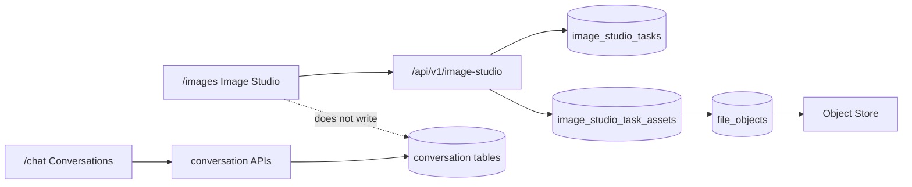

# Image Studio Integration Implementation

设计方案：[image-studio-integration-design.md](./image-studio-integration-design.md)

## 实施概览

本记录描述 Image Studio 模块按设计方案在 DEEIX-Chat 中的实际落地情况。实现保留独立生图业务域，不写入聊天会话、消息、对话列表或最近对话；任务历史通过新增 Image Studio 表保存在云端，图片本体继续复用 DEEIX 文件对象和对象存储。

实施过程中保持“新增文件优先”的策略，只在应用装配、HTTP 路由、数据库迁移、侧边栏入口、i18n 注册等必要位置修改现有文件。

## 后端落地

新增独立 Image Studio 后端域：

- `backend/internal/domain/imagestudio/`
- `backend/internal/application/imagestudio/`
- `backend/internal/repository/imagestudio.go`
- `backend/internal/infra/persistence/postgres/imagestudio/`
- `backend/internal/transport/http/imagestudio/`

新增持久化模型和基线迁移：

- `backend/internal/infra/persistence/models/imagestudio.go`
- `backend/internal/infra/persistence/postgres/imagestudio_baseline.go`

现有文件的必要注册点：

- `backend/internal/app/app.go`
- `backend/internal/transport/http/server.go`
- `backend/internal/infra/persistence/postgres/postgres.go`

实现能力：

- 独立 `/api/v1/image-studio` 鉴权 API。
- 任务列表、详情、收藏、删除。
- 生成和编辑共用流式任务接口。
- 复用 channel 路由、LLM 图片适配器、upload service、billing service。
- 输出图片保存到 DEEIX file objects 和对象存储。
- Image Studio task/assets 表保存云端历史和文件关联。
- 失败任务记录错误摘要，不污染对话表。

关键修正：

- 将 Image Studio 任务 ID 控制在历史字段限制内，并把相关数据库字段扩展到 `varchar(64)`。
- 生成结果仍进入文件库，因此可在“文件”页正常查看和复用。

## 前端落地

新增独立页面和 feature：

- `frontend/app/(project)/images/page.tsx`
- `frontend/features/image-studio/`
- `frontend/shared/api/image-studio.ts`
- `frontend/shared/api/image-studio.types.ts`

现有文件的必要入口扩展：

- `frontend/features/layouts/model/navigation-items.ts`
- `frontend/features/layouts/types/navigation.ts`
- `frontend/i18n/messages.ts`
- `frontend/i18n/messages/zh-CN/common.json`
- `frontend/i18n/messages/en-US/common.json`

实现能力：

- 侧边栏新增“生图”入口。
- `/images` 独立工作台，包含模型选择、任务筛选、任务网格、底部输入栏、详情弹窗。
- 复用公开模型列表，并筛选 `image_gen` / `image_edit` 模型。
- 复用 DEEIX 模型图标解析逻辑，模型图标与系统其它位置保持一致。
- 接入系统 i18n，新增简体中文和英文 Image Studio 文案。
- 接入系统主题 token，保持深色/浅色主题一致。
- 任务图片预览复用文件页的鉴权 blob 加载链路，避免开发环境前后端端口分离时断图。

关键修正：

- 修复 Base UI Combobox 从 uncontrolled 切换到 controlled 的 warning。
- 修复模型图标把 `openai` 等标识直接当 URL 导致断图的问题。
- 修复 Image Studio 卡片和详情弹窗图片裸用 `/api/v1/files/:id/content` 导致预览失败的问题。

## 数据与历史隔离

本次实现没有把 Image Studio 任务写入聊天相关表。历史隔离方式如下：

图片文件本体仍在系统文件库中可见，这是设计内的复用点；但任务历史、收藏、状态、提示词、路由快照不进入聊天列表。

## 验证记录

已执行并通过：

- `go test ./...`
- `corepack pnpm lint`
- `corepack pnpm build`

浏览器验证：

- `/images` 可进入独立生图模块。
- 使用 `gpt-image-2` 可成功生成图片。
- 任务历史保存在云端，刷新后仍可见。
- 图片结果在 Image Studio 卡片和详情弹窗中可正常预览。
- 同一生成文件在“文件”页可正常预览。
- 模型图标解析为 `/vendor/lobehub-icons/openai.svg`，不再断图。
- Image Studio 页面显示简体中文文案。
- Base UI Combobox controlled/uncontrolled warning 已消除。

已确认没有监听中的本地后台服务：

- 前端开发服务 `3100`
- 后端服务 `8080`
- PostgreSQL 容器端口 `5432`
- Redis 容器端口 `6379`

## 当前未完成项

设计方案中的以下体验仍可作为后续阶段继续补齐：

- 蒙版编辑完整工作流。
- Lightbox。
- 重试、再次编辑、批量下载。
- 更细粒度的参数面板。
- 服务端缩略图。
- 管理员用量日志中的 Image Studio 来源标识。

## 运行与回归注意事项

- 本地开发时，Image Studio 预览不能直接使用相对 `/api/v1/files/:id/content` 作为 `` 地址；应继续通过 `fetchFileContent` 拉取 blob 并生成 `objectURL`。
- 删除 Image Studio 任务只隐藏任务历史，不默认删除 file objects，避免影响文件库或其它引用。
- 生成任务的账本记录当前沿用 `conversation_id = 0` 的设计，需要在后续用量展示中避免误读为聊天会话。
- 新增迁移会创建 `image_studio_tasks` 和 `image_studio_task_assets`，并修正相关 ID 字段长度。
